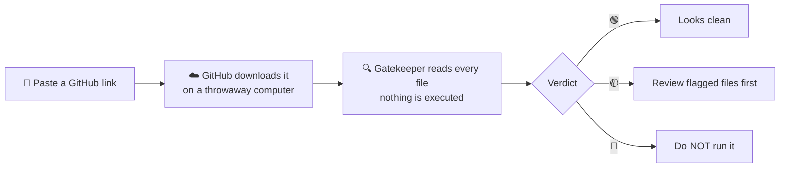

# 🛡️ Repo Gatekeeper

**Check any GitHub repo for malware tricks *before* you download, install, or open it with an AI tool.**
It reads the code and **never runs any of it**.



## How to use it (no install needed)

1. Open this repo on GitHub → click the **Actions** tab.
2. Click **🛡️ Scan a repo before I use it** on the left.
3. Click **Run workflow** → paste the link (e.g. `https://github.com/someone/cool-ai-tool`) → **Run workflow**.
4. Wait ~30 seconds and click the run. The **Summary** page shows the report card:

| Check | Result |
|---|---|
| Remote code | 🟢 clear |
| Obfuscation | 🔴 1 found |
| Data theft | 🟢 clear |
| Install hooks | 🟡 1 found |
| … | … |

Each finding expands to show **the exact file and line** and **why it matters**, in plain English.

## What it catches

| Category | What it looks for | Why you care |
|---|---|---|
| 🌐 Remote code | `curl … \| bash`, downloading and running scripts | The server can send anything, any time |
| 🥷 Obfuscation | base64 code fed to `eval`/`exec`, invisible Unicode ("Trojan Source"), scrambled lines | Hiding what code really does |
| 🔑 Data theft | Reading browser passwords, SSH keys, crypto wallets, sending to Discord/Telegram bots | Classic "stealer" malware |
| 🚪 Backdoor | Reverse shells, auto-start at login | Attacker gets remote control |
| ⛏️ Crypto miner | xmrig, mining pools | Uses your computer to mine for someone else |
| 📦 Install hooks | npm `postinstall`, `setup.py` network calls, VS Code tasks that run when you **open** the folder | Code runs before you've even looked |
| 🤖 AI agent trap | "ignore previous instructions" text, bundled Claude/Cursor hooks & MCP servers | Tricks your AI assistant into acting for the attacker |
| 📁 Sneaky files | Pre-built `.exe`/`.dll`/ELF programs, symlinks pointing outside the repo | You can't read what a compiled program does |
| 🧹 Hygiene | Committed private keys | Not dangerous to you, but a sloppy-author signal |

## Verdicts

- 🟢 **GREEN**: no known tricks found. (Not a guarantee. Still only run code from people you trust.)
- 🟡 **YELLOW**: things a human should glance at, like install scripts or bundled programs. Often legit.
- 🔴 **RED**: strong malware signs. The Action run turns red ❌.

## Run it on your own computer (optional)

Needs only Python 3 (no extra packages):

```bash
git clone --depth 1 https://github.com/owner/repo /tmp/check-me
python3 scanner/gatekeeper.py /tmp/check-me
```

## Develop

```bash
python3 -m unittest discover -s tests -v
```

Add a new check by adding a `Rule(...)` to `RULES` in `scanner/gatekeeper.py` and a test in `tests/`.
